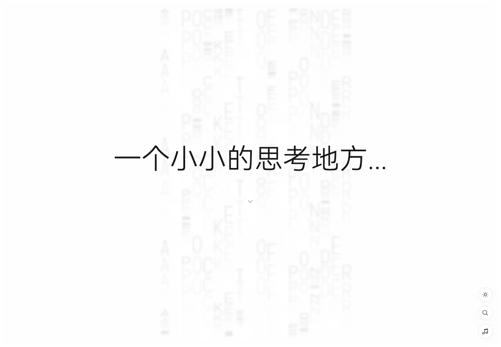
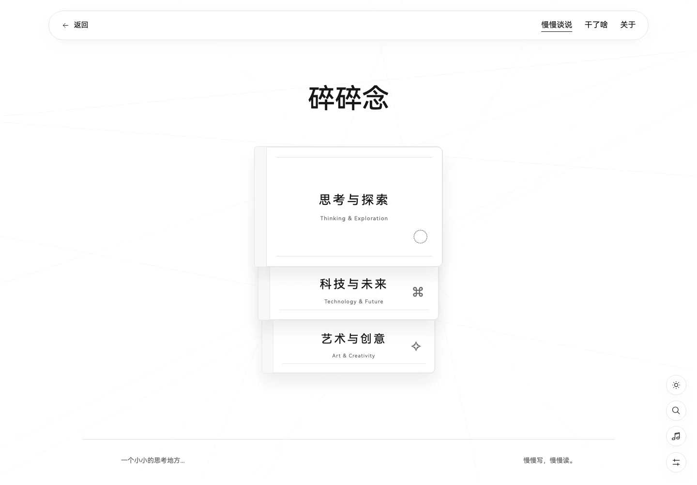
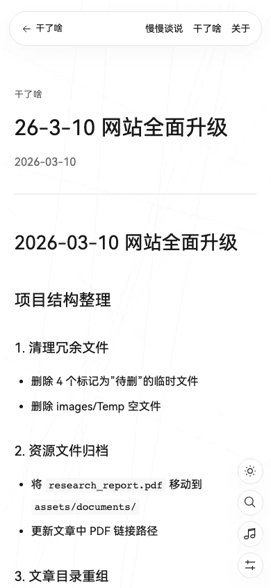
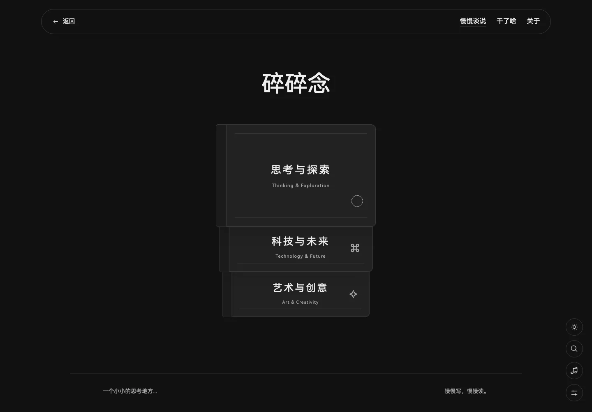

# 迁移与验证报告

本次变更以 main 的 `0a77af1020c193bfbef93f1da53d407005790bc9` 为基线。
验收日期：2026-10-17。交付为可审阅分支与本地生产预览；没有合并、
更改 Pages 设置或发布线上站点。

## 内容与原始资源

- 115 篇文章全部迁入 `src/content/posts/`，元数据使用同一份 Zod schema。
- `npm run validate:migration` 校验每一篇迁移正文与原始正文的 SHA-256。
- 15 个原始媒体文件逐一校验大小和 SHA-256，包括全部原始字体、两张
  GIF、六张照片、MP3、PDF 和图标。
- 原始文件保留。新内容仅维护 Markdown frontmatter，无需更新旧 JSON。
- [迁移映射](migration-manifest.json) 记录原文件名、日期、分类、新网址
  和正文校验值；[原始媒体清单](original-media.json) 记录资源校验值。
- 第七十八天：修复索引中的 20251127 与原文件 20251128 不一致；文章日期
  和新路由按原索引的 2025-11-27 保留。
- 两个非标准原日期的完整值保留在 `legacyDate` 和迁移映射中。
- PDF 相对链接在构建期按项目路径修复，原 Markdown 正文不变。

## 功能与构建

- Astro 静态生成 127 个 HTML 页面，含 115 个独立文章页；另生成正文
  片段、全文搜索索引、sitemap、分享图片、Open Graph 和 BlogPosting 数据。
- `npm run build`：127 页的链接、锚点、脚本、CSS 资源、PDF、图标和
  115 个搜索目的地全部通过检查。
- `npm run check`：零错误、零警告。
- 桌面与手机共 22 项 Playwright 测试通过。每篇迁移文章均检查 HTTP
  状态、元信息、搜索索引、正文片段和来自原文前部/中部/末部的文本。
- 浏览器流程覆盖：真实导航与前进后退、直达和刷新、主题持久化、
  字号、沉浸模式及 Esc、慢网全文搜索、99/第99天检索、搜索重试、
  正文失败重试、100 篇展开和中途取消、音乐失败恢复及跨页恢复进度、
  摄影原图入口、手机布局和减少动态效果。
- [新增文章验证](authoring-check.json)：临时新增一个 Markdown，文章数
  从 115 增至 116，独立页面、栏目、搜索和 sitemap 均自动生成。
  随后删除测试文章并重新构建，恢复为 115 篇；未手动修改任何索引。
- PR 工作流自动执行类型检查、内容与链接校验、写作流程测试、浏览器
  流程和性能门槛，并上传静态预览。发布工作流只允许 main 手动触发。

## 性能门槛

环境：153.0.8010.12 Chromium，390×844 视口，DPR 2，4 倍 CPU 减速，
150 ms 网络延迟、1.6 Mbps 下载/750 Kbps 上传。本地生产构建通过
Chromium CDP 实际限速；每轮新建上下文并禁用缓存，未交互、不打开搜索。
HTTP 未压缩，包含自动请求的字体和当前主题动画。每个页面三轮取中位数。

| 页面                      | LCP 中位数 | CLS 中位数 | 最大首访传输量 |
| ------------------------- | ---------: | ---------: | -------------: |
| /                         |     540 ms |     0.0000 |      851,012 B |
| posts/updates-2026-03-10/ |     572 ms |     0.0000 |      207,109 B |
| categories/exam/          |     604 ms |     0.0075 |      321,776 B |

验收：上述页面 LCP ≤ 2,500 ms、CLS ≤ 0.1；首页首访 ≤ 2,000,000 B。
本轮全部通过。[逐轮数据、请求列表及测试参数](performance-results.json)。
这些是本地实验室测量，不能保证任意设备与公网环境均有相同速度。

原站公网基线出现导航与字体加载超时，因此没有有效的同条件三轮
性能基线，也不声称某个耗时改善百分比。原始文件尺寸、失败情况、
未修改原站的本地截图和请求清单分别保留在 [基线](BASELINE.md) 与
[原始请求清单](baseline-local-requests.json)。

## 媒体优化

- Light / Regular WOFF2 子集：165,128 / 165,444 B；完整原字体继续保留。
- 两张动画：485,654 / 290,846 B，每次仅请求当前主题的一份，保留原循环
  时长；减少动态效果时请求静态图。
- 六张照片生成 640 / 1280 像素 WebP；仅摄影栏目加载，原图按点击打开。
- 音乐首次访问不设置 src；用户播放后才请求。同标签页导航恢复进度；
  浏览器限制自动续播时，界面提示点击继续。

## 视觉核对

已核对桌面/手机首页、笔记本、列表、长文、摄影及暗色视图。
原来的随机 Picsum 占位头像改为“思”字标记；真实作者介绍、邮箱、
GitHub 链接和六张摄影说明均保留。笔记本保留堆叠与翻动效果，并让
下层封面的中文栏目名可见。

优化前首页：

优化后首页与笔记本：

手机阅读与暗色视图：

